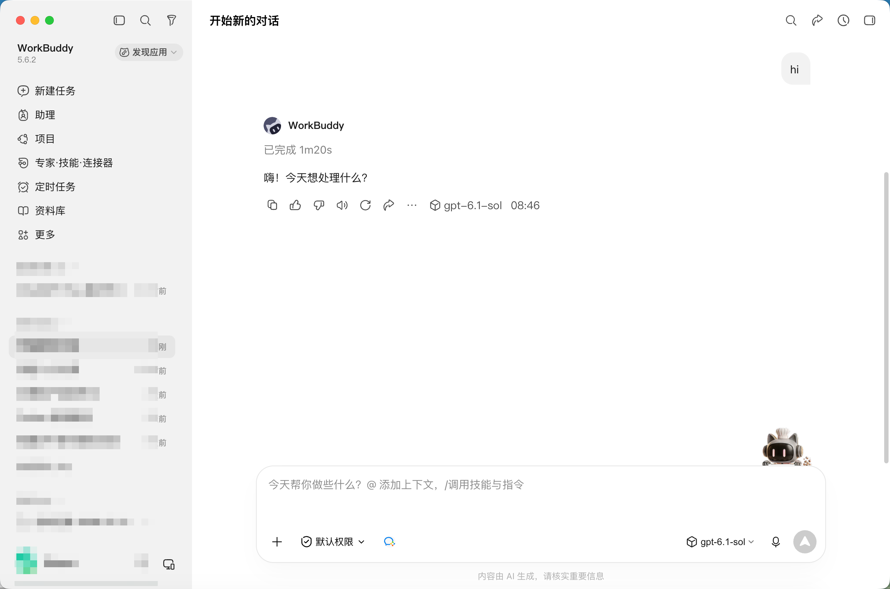
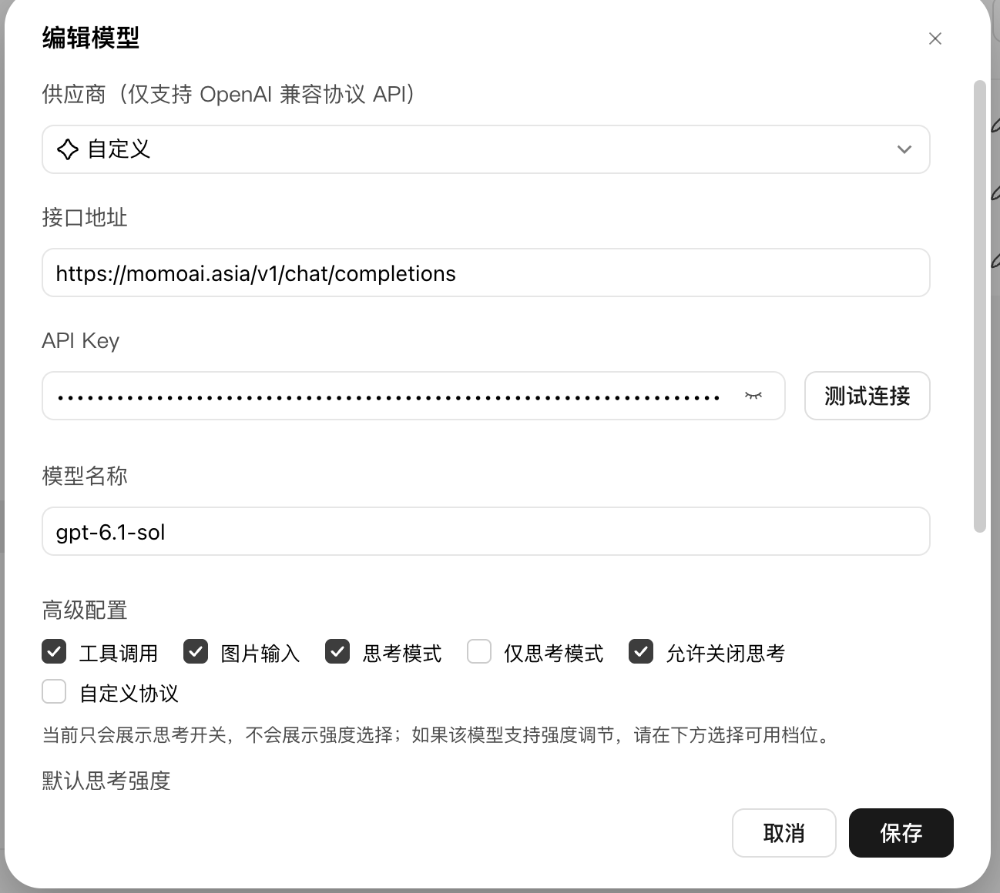
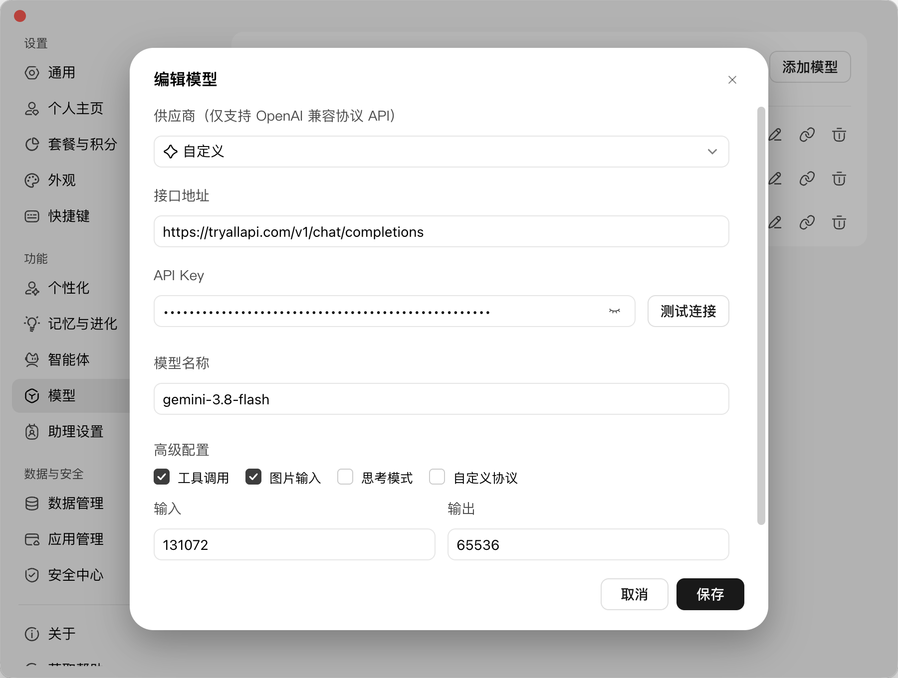

> 在线阅读（GitHub Pages）：https://maynor996.github.io/workbuddy-gpt61-sol/

# WorkBuddy 一键接通 gpt-6.1-sol：MomoAI / TryAllAPI 把最新模型接到桌面

官方客户端默认列表更新慢？新模型出来却用不了？

用 **WorkBuddy** 的自定义供应商，把线路接到 **MomoAI** 或 **TryAllAPI**，模型名填 `gpt-6.1-sol`，桌面端立刻能聊、能写码、能开工具调用——**同一套界面，跟上最新 GPT**。

下面三张都是实机截图：已经在对话里跑通 `gpt-6.1-sol`，以及两条可直接复用的接入配置。

先收藏入口（链接写全，方便下单/开 Key）：

- **MomoAI 包月 / 控制台**：https://momoai.asia/home  
- **MomoAI 站点**：https://momoai.asia  
- **TryAllAPI 全模型 API**：https://tryallapi.com/  

> 正文不写具体价格；套餐与额度以页面实时显示为准。截图里的 Key 已打码，你只要换成自己的即可。

## 一、先看结果：桌面上已经在用 gpt-6.1-sol

很多人卡在「配了模型但不确定有没有生效」。WorkBuddy 里有两处一眼能验真：

1. **回复气泡下方**的模型标签：`gpt-6.1-sol`  
2. **输入框右侧**当前选中的模型名：同样是 `gpt-6.1-sol`  

左侧还有 **新建任务、助理、项目、专家·技能·连接器、定时任务、资料库**——日常工作流不用换软件，只是把「大脑」换成更新、更强的模型。

**一句话**：配对接线，就能在熟悉的 WorkBuddy 里吃到最新 GPT 能力。

## 二、为什么选 MomoAI / TryAllAPI？

| 你的需求 | 更合适的入口 | 能立刻干什么 |
| --- | --- | --- |
| 想稳定用 GPT 最新档、桌面直接聊 | [MomoAI](https://momoai.asia/home) | 自定义接口 + `gpt-6.1-sol`，开工具/识图/思考 |
| 想一条 Key 聚合多模型、随时换线 | [TryAllAPI](https://tryallapi.com/) | 同一自定义供应商换模型名，GPT / Gemini 等都能挂 |
| 两个都想留着对比手感 | 两个都配 | 底部下拉秒切线路，哪条顺手用哪条 |

不用等客户端内置上架；**OpenAI 兼容协议**填好就能测通。新模型上架控制台后，往往 **只改模型名称** 就能继续追新。

## 三、3 分钟接入：编辑模型 → 自定义

路径：**设置 → 模型**（或模型下拉里的编辑/添加）→ **编辑模型**。

| 字段 | 怎么填才稳 |
| --- | --- |
| **供应商** | 选 **自定义**（仅 OpenAI 兼容） |
| **接口地址** | 必须写完整 `.../v1/chat/completions` |
| **API 密钥** | 粘贴后点 **测试连接**，通了再保存 |
| **模型名称** | `gpt-6.1-sol`（以控制台实际 ID 为准） |
| **高级配置** | 建议打开 **工具调用、图片输入**；支持思考就勾 **思考模式** |

保存 → 回对话 → 底部选中该模型 → 发一条真实任务。看到回复标签变成 `gpt-6.1-sol`，就算接通成功。

## 四、方案 A（主推）：MomoAI 接 gpt-6.1-sol

适合想 **快速用上最新 GPT、桌面体验完整** 的同学。先去 https://momoai.asia/home 开好账号 / Key，再按图填写：

- **供应商**：自定义  
- **接口地址**：`https://momoai.asia/v1/chat/completions`  
- **API 密钥**：你的 MomoAI Key → **测试连接**  
- **模型名称**：`gpt-6.1-sol`  
- **高级配置**：勾选 **工具调用、图片输入、思考模式、允许关闭思考**  

**为什么这条线香**：接口一次配好，后面 Sol / Astra 等新 ID 出来，多半只要改模型名；WorkBuddy 侧的项目、定时任务、资料库都能继续用。

现在就去开通：https://momoai.asia/home  

## 五、方案 B：TryAllAPI 挂最新模型（可与 A 并存）

想 **一条 API 玩多家模型**、或给 gpt-6.1-sol 留一条备用线路，用 https://tryallapi.com/ 。截图示例配的是 `gemini-3.8-flash`，步骤完全一样——接 GPT 时把模型名改成 `gpt-6.1-sol` 即可。

- **供应商**：自定义  
- **接口地址**：`https://tryallapi.com/v1/chat/completions`  
- **API 密钥**：TryAllAPI Key → **测试连接**  
- **模型名称**：GPT 填 `gpt-6.1-sol`；也可保留 Gemini 等其它最新 ID 做对照  
- **高级配置**：工具调用 / 图片输入按需开；思考模式看该模型是否支持  
- **输入 / 输出**：示例 131072 / 65536，可按弹窗默认微调  

**推荐玩法**：MomoAI 跑主力 `gpt-6.1-sol`，TryAllAPI 挂第二线路或其它新模型，对话底部一键切换，延迟和效果自己说了算。

开通聚合 API：https://tryallapi.com/  

## 六、照着点就行的清单

1. 打开 https://momoai.asia/home （或 https://tryallapi.com/ ）拿到 Key，确认控制台有 `gpt-6.1-sol`。  
2. WorkBuddy → **编辑模型** → 供应商 **自定义**。  
3. 接口填完整：  
   - MomoAI：`https://momoai.asia/v1/chat/completions`  
   - TryAllAPI：`https://tryallapi.com/v1/chat/completions`  
4. 粘贴 Key → **测试连接** → 模型名 `gpt-6.1-sol` → 勾选能力 → **保存**。  
5. 新开对话选中该模型；确认回复下方标签一致。  

配通一次，后面追新模型成本极低。

## 七、避坑（少走弯路）

**测试连接失败**  
接口是否漏了 `/v1/chat/completions`？Key 是否多空格？网络是否能打开对应站点？

**列表有模型，回复标签却不是它**  
底部下拉还停在旧模型——切换后再发一条新消息。

**思考模式没有强度档**  
有的模型只支持开/关，属正常；能开工具和识图已经很香。

**想一直跟最新 GPT**  
别重装客户端：同一自定义供应商，只改控制台里的新模型 ID。

## 八、收个尾：今天就能用上最新模型

WorkBuddy 负责工作流，**MomoAI / TryAllAPI** 负责把 **gpt-6.1-sol** 等最新模型送到你鼠标边。自定义供应商 + 完整接口 + 一次测试连接，桌面端就能开干。

- 想稳定追 GPT 最新档 → https://momoai.asia/home  
- 想一条 Key 聚合多模型、随时换线 → https://tryallapi.com/  
- 站点首页 → https://momoai.asia  

配好两处验真：**输入框右侧选择器** + **回复下方模型标签**。标签亮起 `gpt-6.1-sol`，就可以把今天的活丢给它了。